<div align="center">


# SchmökerSpot · BookSpot

**Deine Hausbibliothek – gescannt, einsortiert, nichts vergessen.**
Selbst gehostete, quelloffene Progressive Web App für deine Büchersammlung – läuft auf einfachem PHP-Webspace oder mit Docker.

[](https://github.com/tobilektri/BookSpot/actions/workflows/ci.yml)


[](LICENSE)

[English](README.md) · **Deutsch**

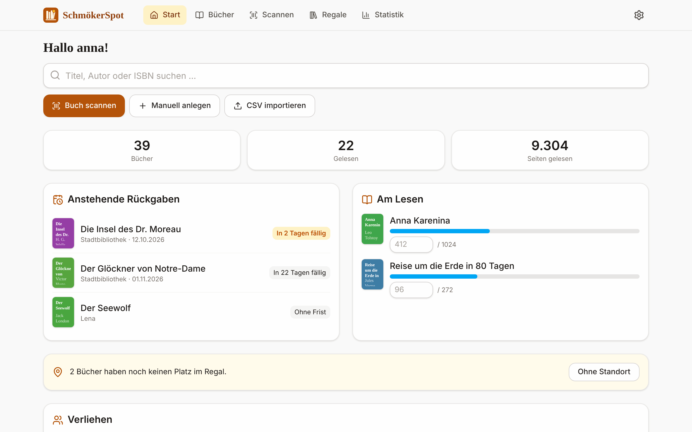

</div>

SchmökerSpot (international: *BookSpot*) beantwortet die Fragen, die jede:r mit mehr als einem
Regal kennt: *Hab ich das schon? Wo steht es? Wann will die Bücherei es zurück?* Barcode mit dem
Handy scannen, Buch ins Fach deines (sehr echten, sehr schiefen) Regals stellen – und sehen, was
alle im Haushalt gerade lesen.

## Das Wichtigste

- 📷 **Barcode-Scan** mit der Handykamera – findet das Buch im Katalog oder holt Titel, Autor, Cover
  und Klappentext von **Open Library**, der **Deutschen Nationalbibliothek** und **Google Books**.
- 📚 **Stapel-Scan** zum Inventarisieren: Fach wählen, dann Buch für Buch scannen („Beep & weiter“).
  Die Buchdaten kommen im Hintergrund – auch offline.
- 🗄️ **Regale, wie sie wirklich sind**: Spalten mit beliebig vielen benannten Fächern (`L1`, `M4` …),
  visuelle Regalansicht, Drag-&-Drop-Editor, „Verschieben nach …“ für mehrere Bücher.
- 👪 **Ein Katalog, private Lesedaten**: Alle im Haushalt sehen dieselben Bücher und Regale;
  Lesestatus, Bewertung, Fortschritt und Notizen hat jede Person für sich.
- ⏰ **Bibliotheks-Ausleihen** mit Standard-Leihfrist und **Push-Erinnerung** 3 Tage und 1 Tag vor der Rückgabe.
- 📈 **Statistik**: Bücher und Seiten pro Monat und Jahr, Genres, Lesetempo, Top-Autor:innen.
- 📥 **Bookstats-CSV-Import** (auch Goodreads/generisch) inkl. Standort-Codes, dazu CSV-Export.
- 📱 **Installierbare PWA**, offline nutzbar, hell und dunkel, deutsche und englische Oberfläche.
- 🔒 **Selbst gehostet & privat**: kein Tracking, Cover liegen auf deinem Server, der Browser spricht
  mit keinem Drittanbieter.

## Kleiner Rundgang

<table>
<tr>
<td width="50%"><br><b>Stapel-Scan</b> – Fach einmal wählen, dann einfach weiterscannen. Doppelte Scans werden abgefangen, vorhandene Bücher ins Fach verschoben.</td>
<td width="50%">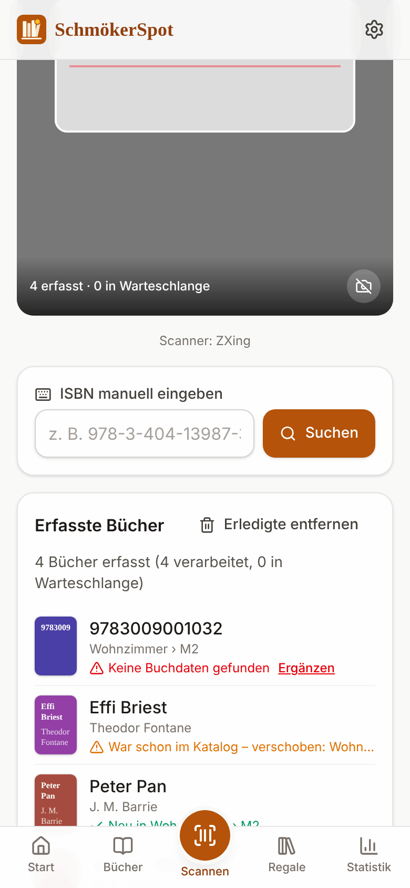<br><b>Live-Liste</b> – neu, verschoben, „Metadaten werden geladen …“ oder „Keine Daten – ergänzen“.</td>
</tr>
</table>

| | |
|---|---|
| 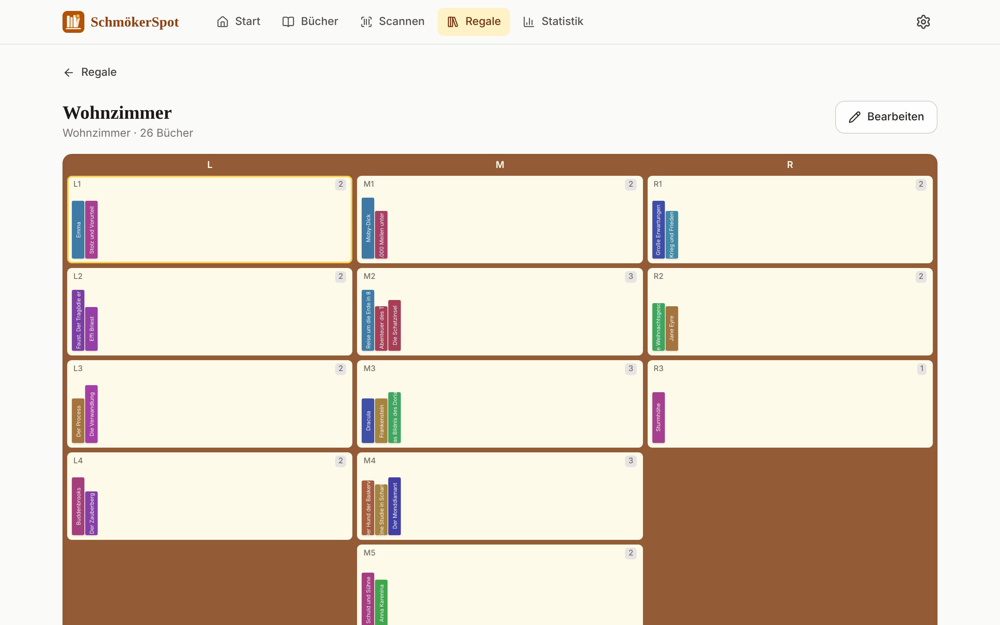<br>**Regalansicht** mit Buchrücken pro Fach | <br>**Regal-Editor** – Fächer und Spalten an ihren Platz ziehen, die Bücher ziehen mit um |
| 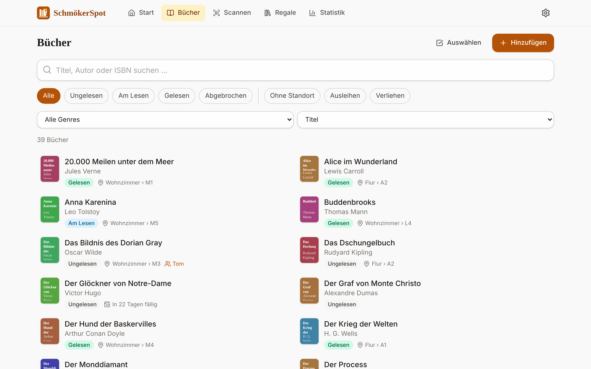<br>**Katalog** mit Suche, Filtern und Sortierung | 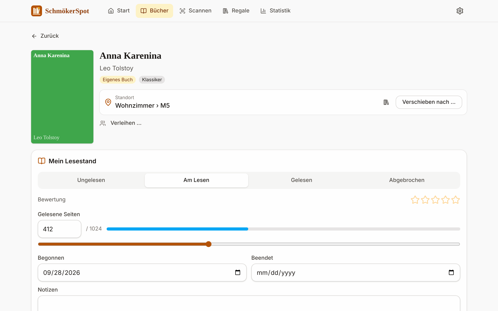<br>**Buchdetails** mit Standort, Lesefortschritt und Bewertung |
| 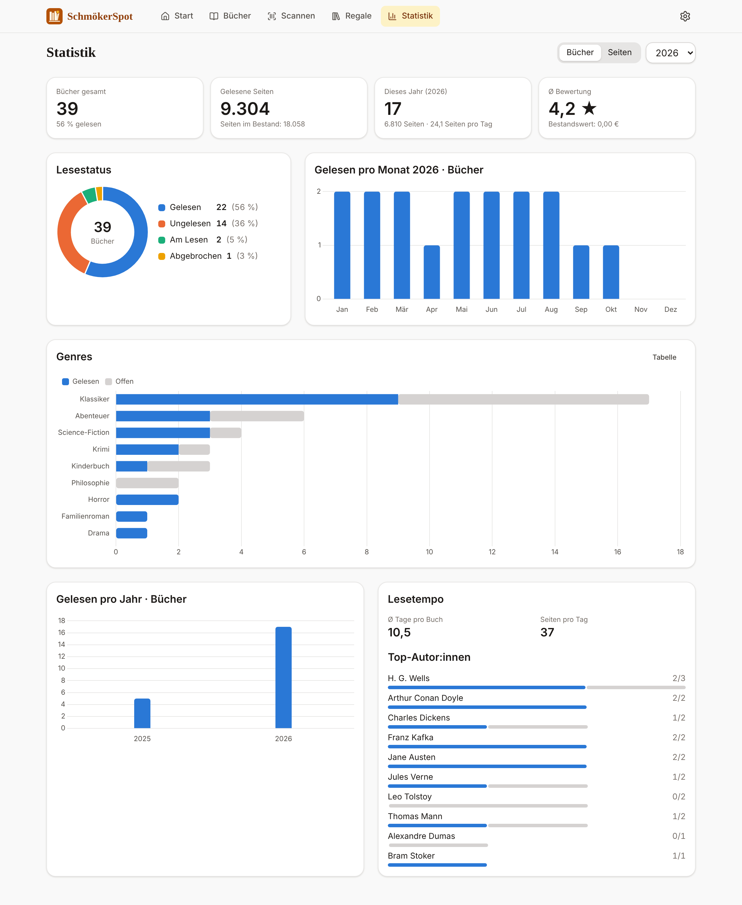<br>**Statistik** fürs Jahr oder insgesamt | 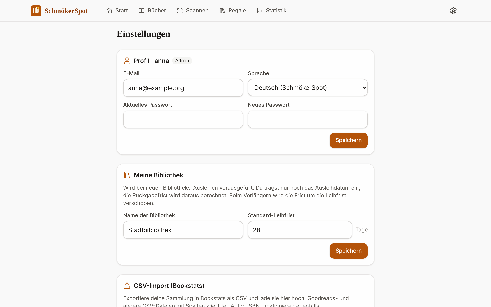<br>**Einstellungen**: Bibliothek, Import/Export, Benutzer, Push, Cronjob |

<p align="center">
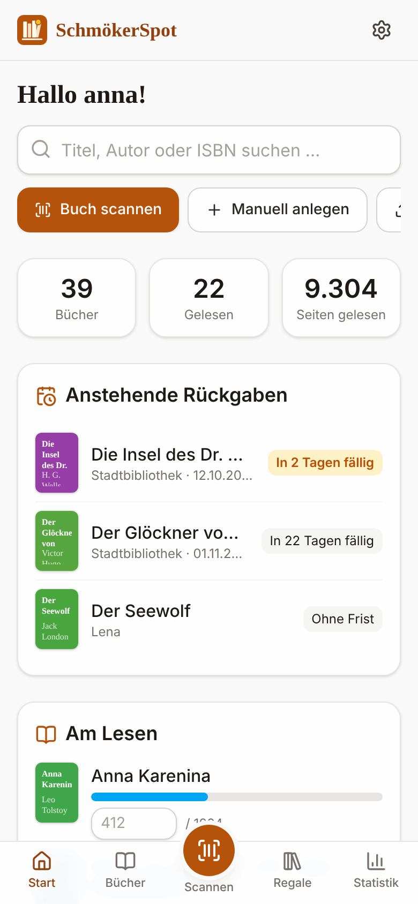
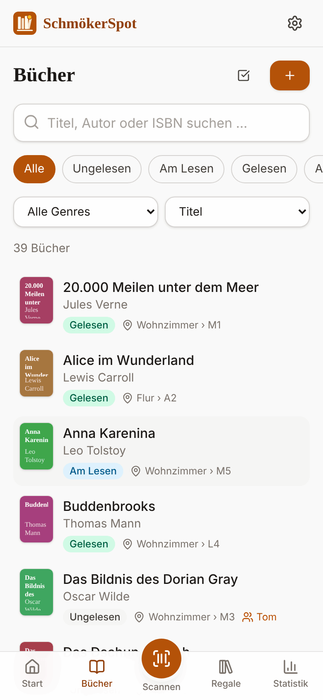
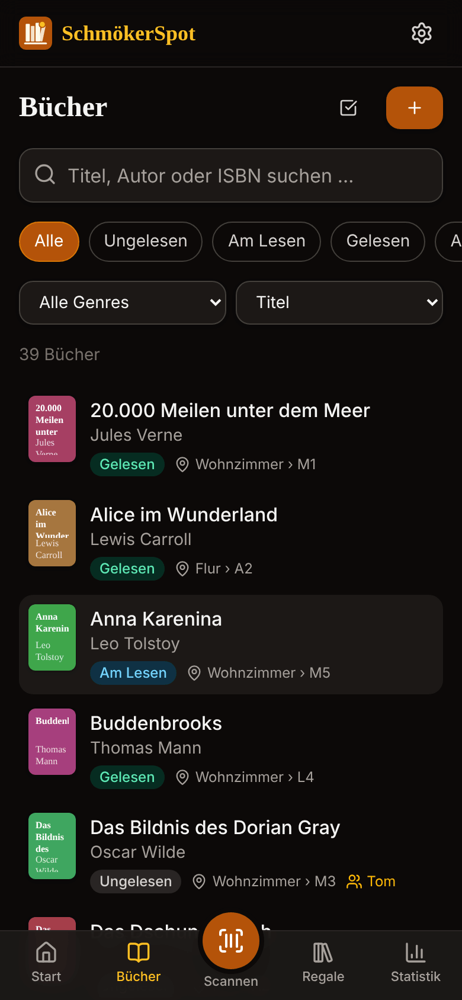
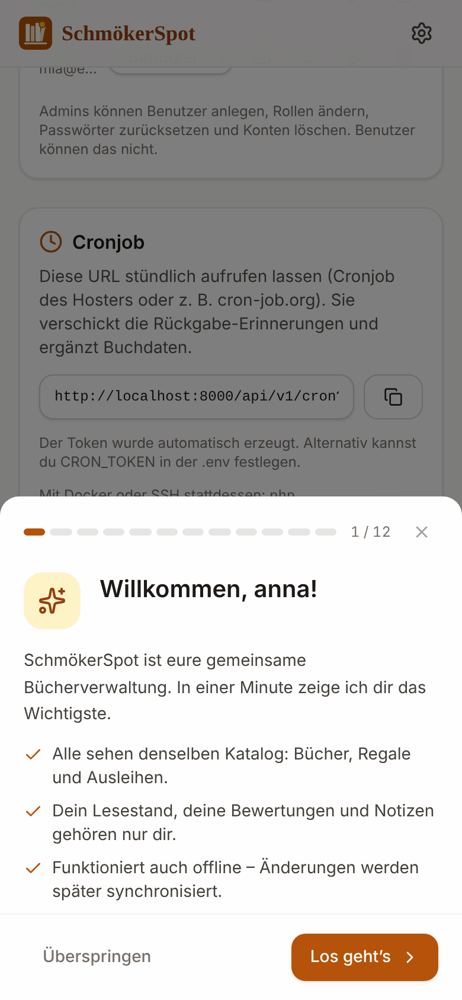
</p>

## Loslegen

### Variante 1 – Webspace / Shared Hosting (ohne SSH, ohne Node.js)

Jeder Hoster mit **PHP 8.2+**, **MySQL/MariaDB** (oder SQLite) und HTTPS reicht. Entwickelt und
getestet wird das Projekt bei [Lima-City](https://www.lima-city.de/?cref=253166) *(Reflink¹)*.

1. `bookspot.zip` aus den [Releases](https://github.com/tobilektri/BookSpot/releases) laden (oder das
   Artefakt `bookspot-bundle` des letzten CI-Laufs) – darin sind `vendor/` und die fertige App enthalten.
2. Per FTP hochladen und die (Sub-)Domain auf den Ordner (oder dessen `public/`-Ordner) zeigen lassen.
3. `.env.example` als `.env` kopieren und Datenbank-Zugangsdaten sowie `APP_URL` eintragen.
4. Seite aufrufen und das erste Konto anlegen – es wird Admin. Die Tabellen entstehen automatisch.
5. Die Cronjob-URL aus *Einstellungen → Cronjob* beim Hoster eintragen.

→ Schritt für Schritt, inkl. Document-Root-Varianten und Updates: **[docs/de/installation.md](docs/de/installation.md)**

### Variante 2 – Docker

```bash
git clone https://github.com/tobilektri/BookSpot.git && cd BookSpot
cp .env.example .env            # DB_PASS, DB_ROOT_PASS, APP_URL setzen
docker compose up -d --build    # → http://localhost:8080
```

nginx + PHP 8.5-FPM + MariaDB + Cron-Container. Details: **[docs/docker.md](docs/docker.md)** (englisch)

### Mit Demo-Daten ausprobieren

```bash
composer install && (cd frontend && npm ci && npm run build)
export DB_DRIVER=sqlite DB_SQLITE_PATH=/tmp/bookspot-demo.sqlite
php backend/bin/demo-data.php de          # Nutzer anna/ben/mia, Passwort „demo-password“
php -S localhost:8000 -t public backend/bin/dev-router.php
```

> **HTTPS ist Pflicht** für Kamera, Service Worker und Push-Benachrichtigungen (außer auf `localhost`).

## Dokumentation

Die ausführlichen Anleitungen sind auf Englisch; die Installation und der Google-Books-Key auch auf Deutsch.

| Thema | |
|---|---|
| [Installation auf Webspace](docs/de/installation.md) · [English](docs/installation.md) | Hochladen, Document Root, Datenbank, Cronjob, Updates |
| [Docker](docs/docker.md) | Container, Volumes, HTTPS-Reverse-Proxy, Backups |
| [Konfiguration](docs/configuration.md) | Alle `.env`-Einstellungen |
| [Scannen & Stapel-Scan](docs/scanning.md) | Kamera, Scanner, Stapel-Modus, Offline-Scans |
| [Regale & Fächer](docs/shelves.md) | Regalmodell, Editor, Drag & Drop, Standort-Codes |
| [Import & Export](docs/import-export.md) | Bookstats-/Goodreads-CSV, Spalten, Duplikate |
| [Buchdaten & Cover](docs/metadata.md) | Quellen, Warteschlange, Rate-Limits, lokale Cover |
| [Google-Books-API-Key](docs/de/google-books-api-key.md) · [English](docs/google-books-api-key.md) | Kostenloser Key für vollständige Buchdaten |
| [Ausleihen & Push-Erinnerungen](docs/loans-and-reminders.md) | Bibliothek, Web Push, iOS |
| [Benutzer & Rollen](docs/users-and-roles.md) | Admins, Einladungen, „Als … anmelden“, Einführung |
| [Offline & App-Installation](docs/offline-pwa.md) | Service Worker, Offline-Warteschlange |
| [REST-API](docs/api.md) | `/api/v1`-Routen, Middleware, Fehler, Limits |
| [Architektur & Sicherheit](docs/architecture.md) | Aufbau, Ablauf einer Anfrage, Schutzmaßnahmen |
| [Entwicklung](docs/development.md) | Lokales Setup, Tests, Demo-Daten, Screenshots, CI |
| [Fehlersuche](docs/troubleshooting.md) | Installieren-Knopf fehlt, 404, Kamera, Push |

## Technik

PHP 8.2+ (Vanilla PDO, kein Framework, eigener kleiner Router) · MariaDB/MySQL oder SQLite ·
Vue 3 + Vite + Tailwind CSS 4 · Dexie (IndexedDB) · Workbox-Service-Worker · Chart.js · ZXing /
natives `BarcodeDetector` · Web Push (VAPID). Getestet mit PHPUnit auf SQLite und MariaDB.

## Mitmachen

Issues und Pull Requests sind willkommen – lokales Setup, Tests und das Neuerzeugen der Screenshots
stehen in [docs/development.md](docs/development.md).

## Lizenz

[MIT](LICENSE)

---

¹ *Reflink: Wenn du dich über diesen Link bei Lima-City anmeldest, erhält der Projektbetreiber ggf.
eine Provision. SchmökerSpot läuft bei jedem Hoster, der die Voraussetzungen erfüllt.*
