<div align="center">


# BookSpot

**Your home library, scanned, shelved and remembered.**
A self-hosted, open-source Progressive Web App for your book collection – runs on plain PHP shared hosting or with Docker.

[](https://github.com/tobilektri/BookSpot/actions/workflows/ci.yml)


[](LICENSE)

**English** · [Deutsch](README.de.md)

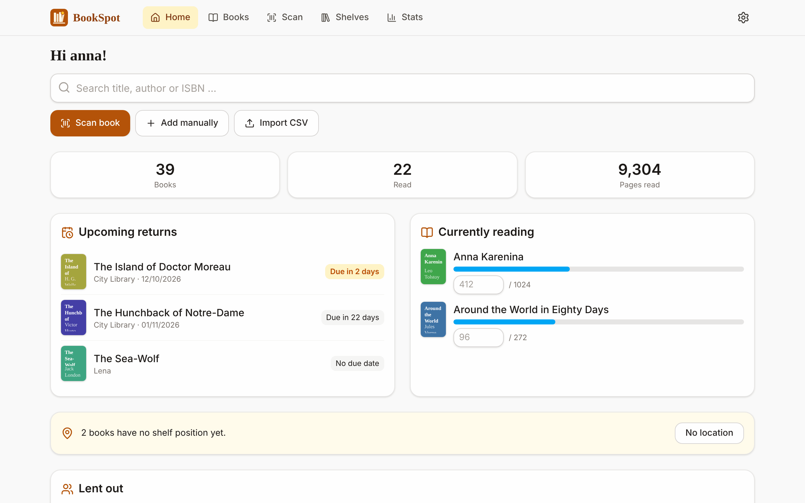

</div>

BookSpot (German edition: *SchmökerSpot*) answers the questions every book lover with more than one
shelf knows: *Do I already own this? Where is it? When does the library want it back?* Scan a
barcode with your phone, put the book into a compartment of your (very real, very asymmetric)
shelf, and keep track of what everybody in the household is reading.

## Highlights

- 📷 **Barcode scanning** with the phone camera – finds the book in your catalogue or fills in title,
  author, cover and blurb from **Open Library**, the **German National Library** and **Google Books**.
- 📚 **Batch scanning** for initial inventory: pick a compartment, then scan book after book
  (“beep & continue”). Book data is loaded in the background – also offline.
- 🗄️ **Shelves the way they really are**: columns with any number of named compartments (`L1`, `M4` …),
  a visual shelf view, drag & drop editor, bulk “move to …”.
- 👪 **One catalogue, private reading data**: everyone in the household sees the same books and shelves;
  reading status, ratings, progress and notes are per person.
- ⏰ **Library loans** with default loan period and **push reminders** 3 days and 1 day before the due date.
- 📈 **Statistics**: books and pages per month and year, genres, reading pace, top authors.
- 📥 **Bookstats CSV import** (also Goodreads/generic CSV) incl. location codes, and CSV export.
- 📱 **Installable PWA**, works offline, light and dark mode, English and German UI.
- 🔒 **Self-hosted & private**: no tracking, covers are stored on your server, the browser never
  talks to third parties.

## A quick tour

<table>
<tr>
<td width="50%"><br><b>Batch scanning</b> – choose the compartment once, then keep scanning. Duplicates are caught, books already in the catalogue are moved into the compartment.</td>
<td width="50%">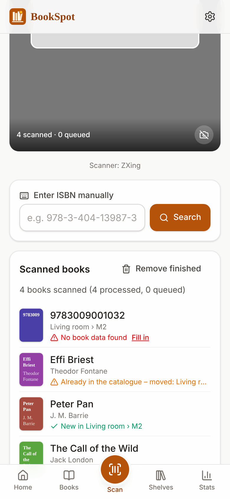<br><b>Live list</b> – new, moved, “loading book data …”, or “not found – fill in”.</td>
</tr>
</table>

| | |
|---|---|
| 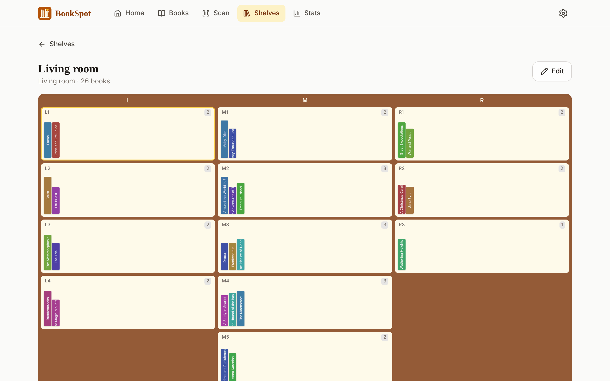<br>**Visual shelf** with book spines per compartment | <br>**Shelf editor** – drag compartments and columns into place, the books move along |
| 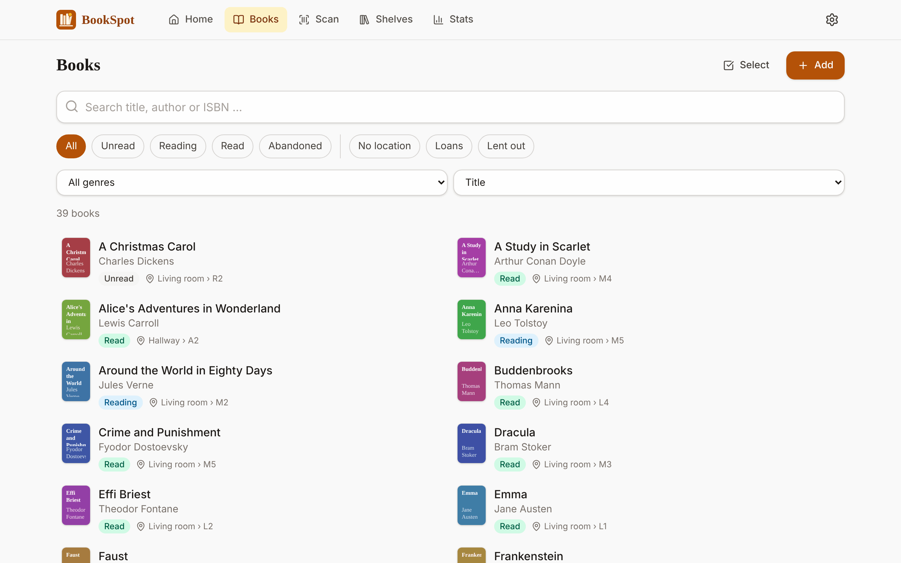<br>**Catalogue** with search, filters and sorting | 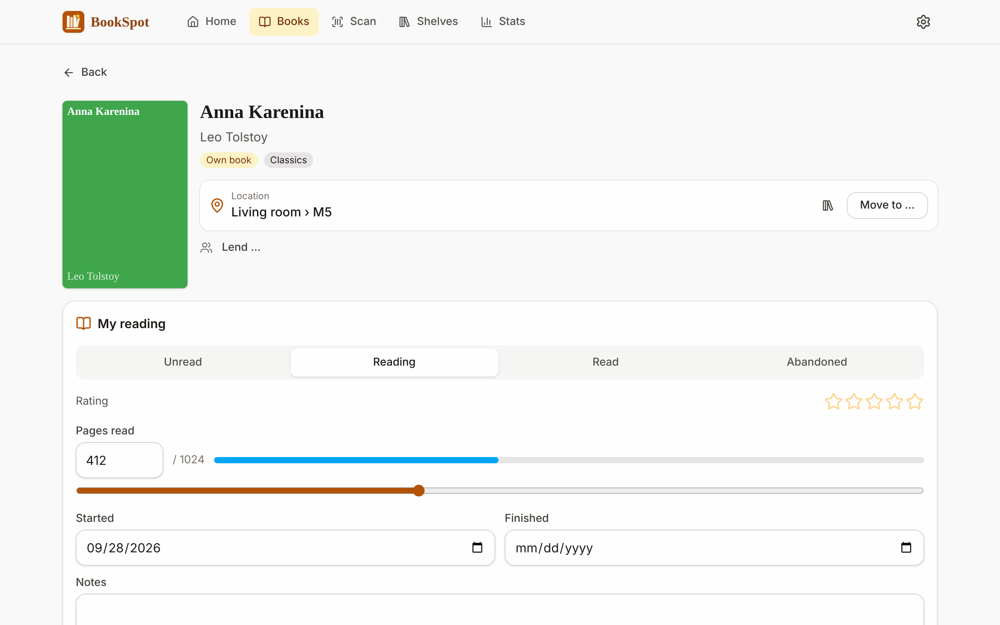<br>**Book detail** with location, reading progress and rating |
| 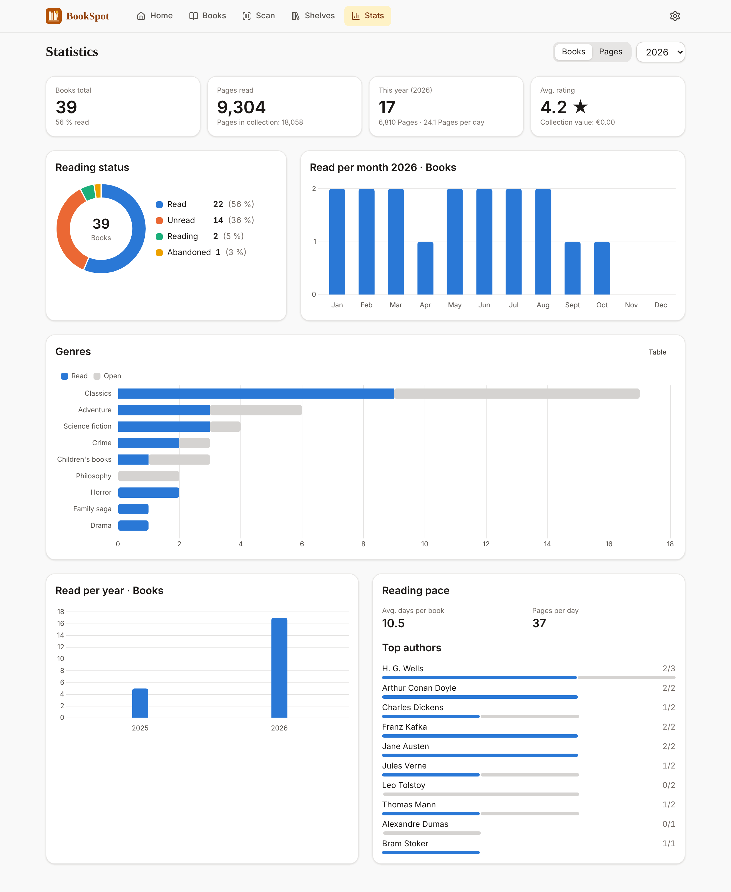<br>**Statistics** for the year or all time | 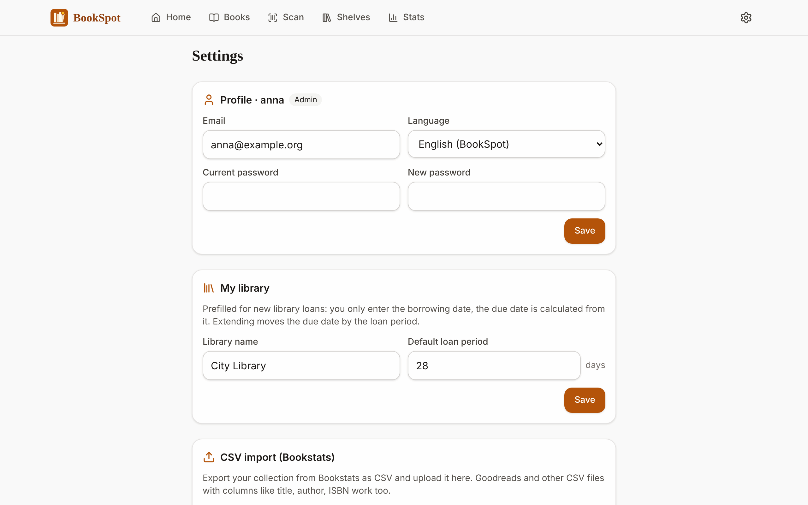<br>**Settings**: library defaults, import/export, users, push, cron |

<p align="center">
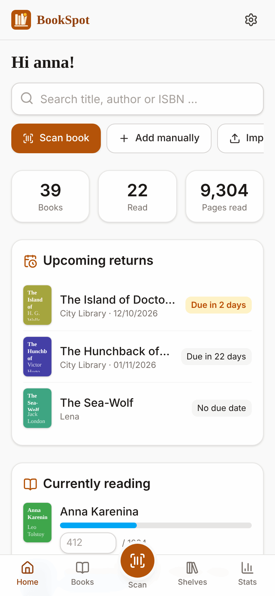
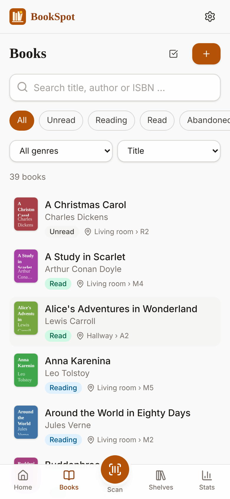
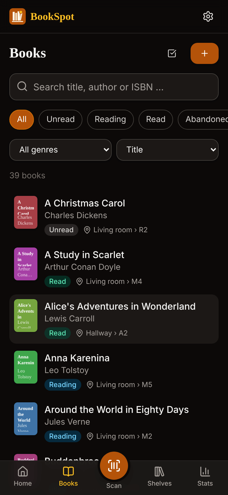
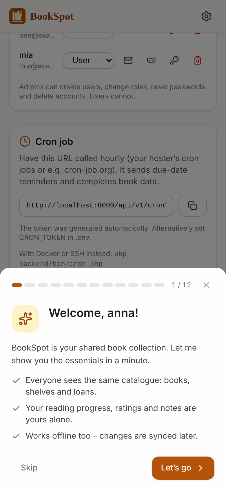
</p>

## Getting started

### Option 1 – shared hosting (no SSH, no Node.js)

Any host with **PHP 8.2+** and **MySQL/MariaDB** (or SQLite) and HTTPS will do. The project is
developed and tested on [Lima-City](https://www.lima-city.de/?cref=253166) *(referral link¹)*.

1. Download `bookspot.zip` from the [releases](https://github.com/tobilektri/BookSpot/releases)
   (or the `bookspot-bundle` artifact of the latest CI run) – it already contains `vendor/` and the built app.
2. Upload it via FTP, point your (sub)domain at the folder (or at its `public/` folder).
3. Copy `.env.example` to `.env` and enter your database credentials and `APP_URL`.
4. Open the site and create the first account – it becomes the admin. Tables are created automatically.
5. Set up the web cron URL shown under *Settings → Cron job*.

→ Step by step, incl. document root variants and updates: **[docs/installation.md](docs/installation.md)**
(German: [docs/de/installation.md](docs/de/installation.md))

### Option 2 – Docker

```bash
git clone https://github.com/tobilektri/BookSpot.git && cd BookSpot
cp .env.example .env            # set DB_PASS, DB_ROOT_PASS, APP_URL
docker compose up -d --build    # → http://localhost:8080
```

nginx + PHP 8.5-FPM + MariaDB + a cron container. Details: **[docs/docker.md](docs/docker.md)**

### Try it with demo data

```bash
composer install && (cd frontend && npm ci && npm run build)
export DB_DRIVER=sqlite DB_SQLITE_PATH=/tmp/bookspot-demo.sqlite
php backend/bin/demo-data.php en          # users anna/ben/mia, password "demo-password"
php -S localhost:8000 -t public backend/bin/dev-router.php
```

> **HTTPS is required** for the camera, the service worker and push notifications (except on `localhost`).

## Documentation

| Topic | |
|---|---|
| [Installation on shared hosting](docs/installation.md) · [Deutsch](docs/de/installation.md) | Upload, document root variants, database, cron, updates |
| [Docker](docs/docker.md) | Containers, volumes, HTTPS reverse proxy, backups |
| [Configuration](docs/configuration.md) | Every `.env` setting explained |
| [Scanning & batch scanning](docs/scanning.md) | Camera, scanner engines, batch mode, offline scans |
| [Shelves & compartments](docs/shelves.md) | Shelf model, editor, drag & drop, location codes |
| [Import & export](docs/import-export.md) | Bookstats/Goodreads CSV, column mapping, duplicates |
| [Book data & covers](docs/metadata.md) | Sources, background queue, rate limits, local covers |
| [Google Books API key](docs/google-books-api-key.md) · [Deutsch](docs/de/google-books-api-key.md) | Free key for complete book data |
| [Loans & push reminders](docs/loans-and-reminders.md) | Library defaults, Web Push, iOS |
| [Users & roles](docs/users-and-roles.md) | Admins, invitations, “sign in as”, introduction wizard |
| [Offline & installation as an app](docs/offline-pwa.md) | Service worker, offline queue, install prompts |
| [REST API](docs/api.md) | `/api/v1` routes, middleware, errors, rate limits |
| [Architecture & security](docs/architecture.md) | Code layout, request flow, security measures |
| [Development](docs/development.md) | Local setup, tests, demo data, screenshots, CI |
| [Troubleshooting](docs/troubleshooting.md) | Install button missing, 404s, camera, push |

## Tech stack

PHP 8.2+ (vanilla PDO, no framework, own small router) · MariaDB/MySQL or SQLite · Vue 3 + Vite +
Tailwind CSS 4 · Dexie (IndexedDB) · Workbox service worker · Chart.js · ZXing / native
`BarcodeDetector` · Web Push (VAPID). Tested with PHPUnit on SQLite and MariaDB.

## Contributing

Issues and pull requests are welcome – see [docs/development.md](docs/development.md) for the local
setup, tests and how to regenerate the screenshots.

## License

[MIT](LICENSE)

---

¹ *Referral link: if you sign up with Lima-City through this link, the maintainer may receive a
commission. BookSpot runs on any host that meets the requirements.*
